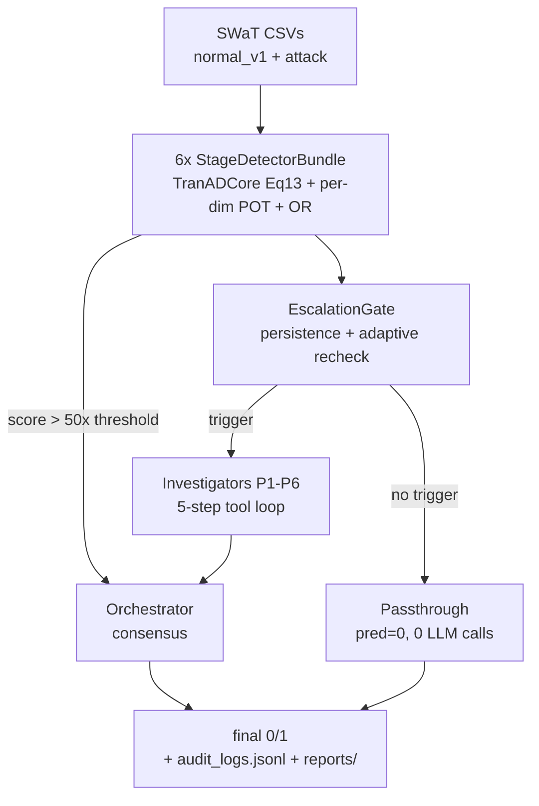

# OT-MAS — TranAD + LangGraph Multi-Agent Anomaly Detection for SWaT

I built a multi-agent system that detects cyber-physical attacks on a water treatment plant: six per-stage TranAD detectors score every 30-second window, a persistence gate filters noise, and LLM investigators verify only suspicious windows.


## Key highlights

* **6 independent TranAD detectors** (K=30, hidden 64, 4 heads, Lc=900) with per-dimension POT thresholds and OR logic — no fixed 0.5 cutoff (`model.py`, `engine.py`, `detector.py`).
* **Last full run:** strict P 0.9488 / R 0.2337 / F1 0.3750 (TP 426, FP 23, FN 1397, TN 13151) and point-adjusted F1 0.8541 over 14,997 windows. Reproduce with `python grade_system.py`.
* **Cost-aware gating:** persistence + adaptive recheck + passthrough path means most windows cost zero LLM calls; 807/14,997 windows triggered investigation in the last run.
* **Grounded LLM verdicts:** investigators run a bounded 5-step tool loop (`query_sensors`, `check_physical_rules`, `compare_to_baseline`) and return a Pydantic `StageVerdict`; the orchestrator merges them into `ATTACK`/`NORMAL`.

## Demo

Real ATTACK window from the last full run (`audit_logs.jsonl`, window 261 of 14,997):

```
window 261 | 2015-12-28 12:10:59 | pred=1 gt=1
scores:   P3 0.010900 (thr 0.000910, ~12x) | P4 0.000338 | P5 0.000022
triggers: P3=True, P4=False, P5=False  -> P3 investigator dispatched
P3 investigator: query_sensors -> check_physical_rules -> True Positive (0.95)
  "FIT301 reports flow (2.21) while MV301-MV304 are closed — likely tampering"
orchestrator (gpt-oss-120b): ATTACK, involved stages [P3]
```

Why this window matters: it is the first detection in attack segment 256–270 (latency 5 windows / 150s), and the verdict rests on a physical-constraint violation, not just a high score. Full report: `reports/2026-07-26/incident_window_261.md`. Reproduce: `python grade_system.py --audit-path audit_logs.jsonl`.

## Architecture

`data/*.csv` → `load_data` → 6× `StageDetectorBundle` (MinMaxScaler + TranADCore + per-dim POT) → `EscalationGate` → LangGraph (`detector` → investigators → `orchestrator`, or `passthrough` / critical override) → `audit_logs.jsonl` + `reports/` + `mas_langgraph_results.csv`.



Components: `main.py` entrypoint, `graph.py` flow, `detector.py` scoring, `escalation_gate.py` gating, `agents/investigator.py` + `agents/orchestrator.py`, `state.py` schemas, `groq_client.py` key rotation.

## Features

**Detection:** per-stage TranAD, streaming `C_j` prefix (capped at 900 rows), per-sensor attribution for diagnosis.
**Cost control:** persistence gate, severity multiplier, fixed/adaptive recheck, 50× critical-override fast path, TPD fallback to pure-detector mode.
**Agents:** 4-function tool schemas, Pydantic-enforced verdicts, 3-model fallback chain per role, 60s per-window timeout.
**Eval:** strict + point-adjusted P/R/F1, per-stage ROC-AUC, Hit@P% / NDCG@P, segment latency, `grade_system.py` report.

## Benchmarks / Results

| Metric | Value (last run) |
|---|---|
| Windows | 14,997 (30-row, non-overlapping) |
| Strict P / R / F1 | 0.9488 / 0.2337 / 0.3750 |
| TP / FP / FN / TN | 426 / 23 / 1397 / 13151 |
| Point-adjusted P / R / F1 | 0.9836 / 0.7548 / 0.8541 |
| Windows triggering LLM | 807 |
| LLM calls | 4,912 |
| Prompt / completion tokens | [TODO: tokens — see below] |
| Per-stage AUC | [TODO: run `python train.py --all --eval`] |

Methodology: hardware [TODO: chip + RAM, e.g. Apple Silicon M1/16GB]; workload = full `data/attack.csv` from `START_WINDOW=0`, `MAX_WINDOWS=15000`; detector-only AUC is gate-free (`train.py --eval`); MAS metrics from `audit_logs.jsonl` via `python grade_system.py --audit-path audit_logs.jsonl`. Single run — no mean±std yet.

Note: token counts disagree between sources (old README: 5.88M/2.48M; `grade_system.py` hardcodes 2.26M/1.35M). Rerun grading on the current audit log to confirm.

## Design decisions and trade-offs

1. **Six small detectors vs. one monolith.** Per-stage models isolate sensor distributions (P5 RO vs. P1 hydraulics) and allow per-dim POT. Cost: 6× training and thresholds. `weights/monolithic_tranad.pth` is unused legacy.
2. **Per-dimension POT + OR vs. scalar threshold.** Fits an EVT tail per sensor instead of averaging away a single spiking sensor. Cost: more thresholds to calibrate; `weights/thresholds.json` currently holds only P6.
3. **Persistence gate vs. per-window LLM.** Requires N consecutive breaches before investigating, cutting calls to 807/14,997. Cost: 30–60s added delay; misses single-window bursts.
4. **Tool-calling loop (max 5) vs. single prompt.** Forces `query → physics-check → baseline → verdict` with parseable `StageVerdict`. Cost: 3–5× tokens per investigation vs. one-shot.
5. **50× critical override vs. pure LLM consensus.** Physically impossible scores skip debate and emit `ATTACK`. Cost: a miscalibrated threshold could auto-escalate noise.

## Quick start

```bash
# 1. Python 3.12 required (repo venv runs 3.12.4; system 3.14 will fail)
python3.12 --version

# 2. Install
python3.12 -m venv .venv && source .venv/bin/activate
pip install -r requirements.txt

# 3. Configure (required — clone ships without keys/data/weights)
cp .env.example .env
# edit .env: add GROQ_API_KEY_1=... (up to _20 supported)
# place data: data/normal_v1.csv, data/attack.csv (gated SWaT license, not in git)

# 4. Smoke test, then full run (~3.5h on Apple Silicon)
MAX_WINDOWS=100 python main.py
MAX_WINDOWS=15000 python main.py

# 5. Evaluate
python grade_system.py --audit-path audit_logs.jsonl  # -> grade_report.md
python train.py --all --eval  # gate-free detector AUC per stage, no LLM cost
```

Env flags: `START_WINDOW` resumes, `GATE_PERSISTENCE=2`, `GATE_SEVERITY_MULT=1.0` (disabled), `GATE_RECHECK=none` (adaptive 8/13/6). Verified against `main.py`.

> Flags / broken bits: `requirements.txt` is unpinned (`torch`, `langgraph`, `groq` float) — run `pip freeze` after a good run and pin. `data/` and `weights/*.pth` are gitignored, so a fresh clone cannot run until you add them. `thresholds.json` is incomplete (only P6) — others fall back to frozen values in `detector.py`.

## Project structure

```
main.py                 # full MAS run, metrics + CSV + reports/
train.py                # per-stage train / calibrate / --eval
graph.py                # LangGraph: detector -> investigators -> orchestrator
detector.py / engine.py / model.py   # scoring, training loop, TranADCore
escalation_gate.py      # persistence + adaptive recheck gate
agents/                 # investigator.py, orchestrator.py (tool loops)
tools.py                # ACTIVE_STAGES + 4 tools (physics rules: P3-P5 only)
state.py / metrics.py / data_utils.py / diagnosis_labels.py
configs/stage_p*.yaml   # per-stage features + Lc
weights/                # agent_p*.pth + thresholds.json (gitignored)
data/                   # NOT in git — SWaT CSVs go here
grade_system.py         # audit-log grading -> grade_report.md
```

## Testing

No unit tests (`**/test*.py` finds none). Current verification is end-to-end:

```bash
.venv/bin/python train.py --all --eval
.venv/bin/python grade_system.py
```

Covers: `metrics.py` strict/adjusted scoring, per-sensor ground truth, gate trigger counts. Missing: mocked-LLM investigator tests, gate unit tests, multi-seed repeats.

## Limitations and future work

* Recall 0.23 strict — many attacks missed; point-adjusted flatters latency.
* `check_physical_rules` covers only P3/P4/P5; P1/P2/P6 rely on statistics alone.
* ~5K LLM calls per full run is expensive; needs caching + cheaper first pass.
* Single run, Apple Silicon only; need 5× `START_WINDOW` offsets + mean±std.
* Next: backfill `thresholds.json`, add P1/P2/P6 rules, add `pytest` gate + tool tests.

## Tech stack

PyTorch (TranAD) · LangGraph + LangChain-Core · Groq (Qwen 3.6 27B, GPT-OSS 120B/20B, Llama 3.3 70B) · Pydantic v2 · pandas / NumPy / scikit-learn · PyYAML · python-dotenv

## Contact

* GitHub: [@ima-d-ice](https://github.com/ima-d-ice) — repo `MASOTCYBER`
* Dataset: SWaT (iTrust, SUTD) — request access separately, not redistributable.
* License: MIT — see `LICENSE`.
